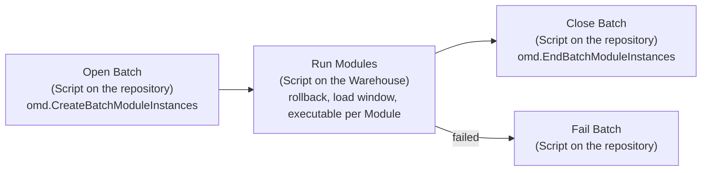

# DIRECT on Microsoft Fabric

Standard Data Factory pipelines that run DIRECT Batches and Modules in a Microsoft Fabric workspace, with the DIRECT repository in a SQL database in Fabric and the data in a Fabric Warehouse. The pipelines are a standard asset of the framework: deploy them once per workspace and point them at the repository and the Warehouse through a Variable Library. Code generators (such as Agnostic Data Labs) only have to register Batches and Modules in the repository and set the library values.

Requires DIRECT 2.2.0 or later (procedures `omd.CreateBatchModuleInstances` and `omd.EndBatchModuleInstances`, see the external orchestration section in [Documentation.md](../Documentation/Documentation.md)).

## How a Batch runs



A Batch run is three activity runs, whatever the number of Modules and child Batches:

1. **Open Batch** creates and evaluates the Batch Instance and the Module Instances of all active Modules in the Batch, in sequence, and then does the same for every active child Batch (`omd.BATCH_HIERARCHY`), recursively, with the Batch Instance as parent. This is the order `omd.RunBatch` uses: the Modules of a Batch first, then its child Batches in sequence. It returns the Modules to run as one JSON array in run order: Module Instance Id, Batch, executable, previous load window end value, rollback statement (when an earlier instance failed) and, for configured Module Types, a consistency timestamp. Nothing is executed yet.
2. **Run Modules** runs on the Warehouse. For every Module in order it runs the rollback statement, determines the end of the load window as the maximum of the load window attribute in the source data object (the start value when the source is empty, the current time when the source has no such attribute), runs the executable through `sp_executesql` with the parameters `@ModuleInstanceId`, `@StartValue`, `@EndValue` and `@ConsistencyDateTime`, and counts the target rows before and after (a target with fewer rows than before counts as reset and reloaded). A failing Module is recorded and the next Module runs. The result is one JSON row per Module.
3. **Close Batch** hands the results to `omd.EndBatchModuleInstances`, which records the load windows in `omd.SOURCE_CONTROL`, closes the Module Instances with their row counts, writes failure details to the event log, fails Module Instances that were left without a result, closes the child Batch Instances from the deepest level up and finally the Batch Instance itself. A failed Module or child Batch fails its Batch. The activity fails after the bookkeeping when something failed, so that the pipeline run shows the failure.

So a main Batch that calls a Batch per layer, which in turn call the Batches of that layer, runs as one pipeline run with three activities and a full DIRECT audit trail at every level (one Batch Instance per Batch, linked through `PARENT_BATCH_INSTANCE_ID`). Any Batch in the hierarchy can be run on its own with the same pipeline, with its own children.

The pipelines have concurrency 1: a run that starts while the previous one is still running waits. Together with the Abort evaluation of DIRECT this makes a short schedule (a trickle feed) safe. Schedule the main Batch at an interval that is longer than a full run.

## Pipelines

| Pipeline | Parameters | Purpose |
| --- | --- | --- |
| `DIRECT Run Batch` | `BatchCode`, `ParentBatchInstanceId` (default `0`) | Runs a Batch with all its child Batches as described above. This is the pipeline to schedule, with the main Batch. |
| `DIRECT Run Module` | `ModuleCode` | Runs one Module outside a Batch, for development and reruns. |

## The executable contract

The `EXECUTABLE` of a Module is T-SQL that runs on the Warehouse. It may use these parameters, which the Run Modules activity declares and binds:

| Parameter | Type | Value |
| --- | --- | --- |
| `@ModuleInstanceId` | `BIGINT` | The Module Instance Id of this run, to be written as the audit trail of the inserted rows. |
| `@StartValue` | `VARCHAR(100)` | The end value of the previous load window of the Module (`DefaultStartValue` for the first run). |
| `@EndValue` | `VARCHAR(100)` | The end of this load window: `MAX(<LoadWindowAttributeName>)` of the source data object; `@StartValue` when the source is empty; the current time when the source has no such attribute. |
| `@ConsistencyDateTime` | `VARCHAR(100)` | The consistency timestamp for Modules whose type is in `ConsistencyModuleTypeList`, otherwise `NULL`. |

Example registration:

```sql
EXEC [omd].[RegisterModule]
   @ModuleCode = N'm_SAT_CUSTOMER_PSA_CRM_CUSTOMER'
  ,@ModuleType = N'Satellite'
  ,@AreaCode = N'INT'
  ,@DataObjectSource = N'[psa].[CRM_CUSTOMER]'
  ,@DataObjectTarget = N'[dv].[SAT_CUSTOMER]'
  ,@Executable = N'EXEC [dv].[SP_SAT_CUSTOMER_PSA_CRM_CUSTOMER] @AUDIT_TRAIL_ID = @ModuleInstanceId, @StartValue = @StartValue, @EndValue = @EndValue';
```

`DATA_OBJECT_SOURCE` and `DATA_OBJECT_TARGET` are Warehouse object names as they can be used in a `FROM` clause (three-part names for other databases in the workspace are fine). The rollback statement that DIRECT builds for failed instances is a `DELETE` on the target by the Module Instance Id column, so the target needs that column (`ModuleInstanceIdColumnName`, default `MODULE_INSTANCE_ID`).

## Settings: the DIRECT Variable Library

All environment-specific values live in a Variable Library named `DIRECT` in the workspace. The pipelines bind to its variables by name.

| Variable | Meaning |
| --- | --- |
| `WorkspaceId` | The workspace that holds the repository database and the Warehouse. |
| `RepositoryDatabaseItemId` | Item id of the SQL database in Fabric with the DIRECT repository. |
| `RepositoryConnectionId` | Id of a Fabric SQL database connection (OAuth2, caller identity) to the repository. |
| `WarehouseItemId`, `WarehouseEndpoint` | Item id and SQL endpoint of the Warehouse. |
| `WarehouseConnectionId` | Id of a Warehouse connection (OAuth2, caller identity). |
| `ModuleInstanceIdColumnName` | Module Instance Id column in the target data objects (rollback). Default `MODULE_INSTANCE_ID`. |
| `DefaultStartValue` | Load window start for a Module without a recorded load window. Default `1900-01-01`. |
| `LoadWindowAttributeName` | Attribute whose maximum in the source data object ends the load window. Default `INSCRIPTION_TIMESTAMP`. |
| `ConsistencyModuleTypeList` | Comma-separated Module Types that get a consistency timestamp. Default empty. |
| `SourceTimestampColumn` | Timestamp column for `omd.GetConsistencyTimestamp`. Default `LOAD_DATETIME`. |

Value sets of the library can hold the values per environment (development, test, production) when the workspace is deployed through deployment pipelines.

## Deployment

Two routes lead to the same result.

**Script (for example a workshop workspace).** With PowerShell 7, the `Az.Accounts` module and `Connect-AzAccount` done with an account that has a Fabric license and access to the workspace:

```powershell
cd fabric/scripts
./Deploy-DirectFabric.ps1 -WorkspaceId <workspace id> -RepositoryDatabaseItemId <sql database item id> -WarehouseItemId <warehouse item id> -ConsistencyModuleTypeList 'PIT'
./Invoke-DirectPipeline.ps1 -WorkspaceId <workspace id> -PipelineName 'DIRECT Run Batch' -BatchCode 'b_MAIN'
./Set-DirectSchedule.ps1 -WorkspaceId <workspace id> -BatchCode 'b_PROJECT' -IntervalMinutes 5
./Set-DirectSchedule.ps1 -WorkspaceId <workspace id> -Disable
```

All three scripts take `-TenantId` for accounts that span several Entra tenants; the token comes from the Az context of a user with a Fabric license.

`Deploy-DirectFabric.ps1` creates the two connections for the signed-in user when no connection ids are given (a workspace identity is refused by Fabric for connections to a SQL database in Fabric), creates or updates the Variable Library with the values, and creates or updates the three pipelines from `items/*.DataPipeline/pipeline-content.json`. It is safe to run again.

**Git integration (your own workspace).** The `items` folder follows the Fabric Git item layout (`<name>.DataPipeline` with `.platform` and `pipeline-content.json`, `DIRECT.VariableLibrary` with `variables.json` and `settings.json`). Point the workspace Git connection at this folder, or copy the item folders into the folder that is connected, and set the Variable Library values for the workspace after the first sync. The connections still have to exist; create them in the portal (Manage connections and gateways) or with `Deploy-DirectFabric.ps1`.

## Folder layout

| Path | Content |
| --- | --- |
| `items/` | The deployable Fabric items: two pipelines and the Variable Library, in the Git item layout. |
| `sql/` | The T-SQL of the Script activities, one file per activity. Edit these, not the JSON. |
| `templates/` | The pipeline definitions with `{{sql:<file>}}` tokens where the activity scripts go. |
| `scripts/Build-PipelineDefinitions.ps1` | Builds `items/*/pipeline-content.json` from the templates and the SQL files. Run after a change and commit the result. |
| `scripts/Deploy-DirectFabric.ps1` | Deploys connections, Variable Library and pipelines to a workspace through the Fabric REST API. |
| `scripts/Invoke-DirectPipeline.ps1` | Runs a pipeline on demand and waits for the result. |
| `scripts/Set-DirectSchedule.ps1` | Creates, updates or disables the schedule of a pipeline (the trickle feed). |
| `scripts/FabricApi.ps1` | Shared REST helpers (token, long-running operations, item and connection lookup). |

## Cost and timing

Fabric meters pipeline orchestration per activity run. A Batch run costs three activity runs (four when a Module fails), independent of the number of Modules and child Batches. A Batch of a few Modules completes in under a minute, most of which is activity start-up; the Module procedures themselves take well under a second each inside the Warehouse session, so a main Batch with some seventy Modules in three layers runs in a few minutes.

## Notes

- The Warehouse has no `IDENTITY`, `DEFAULT`, enforced keys or `nvarchar`/`datetime2(7)` columns in persisted tables; the executables and their target tables have to follow the Warehouse dialect. Expression types inside procedures are not limited, so hash keys can be computed as on SQL Server.
- The schedule runs under the identity of the user who created it; the connections use the caller's identity as well.
- `omd.RunBatch` and `omd.RunModule` remain the way to run Modules whose code lives inside the repository database; the pipelines are for data on another engine.
