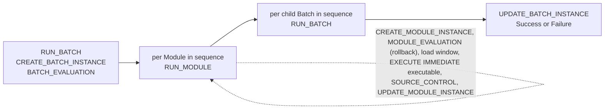

# DIRECT on Snowflake

The Snowflake edition of the DIRECT Framework: the repository, the reference data, the registration, evaluation and run procedures, the reporting views and a queue based on Snowflake Tasks, all in Snowflake SQL and Snowflake Scripting. The framework is a standard asset: deploy it once into a database and register Batches and Modules in it. Code generators (such as Agnostic Data Labs) only have to produce the registration script, the executables and, for a trickle feed, the schedule.

Requires the Snowflake CLI (`snow`) for the scripted deployment; a Snowsight worksheet works as well (see Deployment).

## How a Batch runs



`OMD.RUN_BATCH('b_MY_BATCH')` creates and evaluates a Batch Instance, runs the active Modules of the Batch in `SEQUENCE` order, then the active child Batches (from `OMD.BATCH_HIERARCHY`) in sequence with the Batch Instance as parent, and closes the Batch Instance. A Batch that only groups child Batches works the same way. The procedure returns an object with the Batch Instance Id, the execution status and the counts of Modules and child Batches run and failed.

`OMD.RUN_MODULE('m_MY_MODULE')` runs one Module, inside a Batch or stand-alone. It creates the Module Instance, evaluates it (Abort when another instance of the Module is executing, Cancel when the Module is inactive or succeeded in an earlier run of a Batch that is being restarted, otherwise Proceed after rolling back the rows of earlier failed instances), determines the load window, runs the executable, records the load window in `OMD.SOURCE_CONTROL` and closes the Module Instance with the row count.

The evaluation logic is that of the SQL Server edition: one executing instance per Batch and per Module, inactive Batches, Modules and relationships are skipped, a failed run is rolled back on the next run (`DELETE` on the target data object by the Module Instance Id column), and the Modules that succeeded in a failed Batch run are skipped when the Batch is restarted (partial rollback; set the previous Batch Instance's `NEXT_RUN_STATUS_CODE` to `Rollback` for a full rollback).

## The executable contract

The `EXECUTABLE` of a Module is a SQL statement that runs in the repository database through `EXECUTE IMMEDIATE`. Before it runs, `RUN_MODULE` replaces these tokens:

| Token | Replaced by |
| --- | --- |
| `:ModuleInstanceId` | The Module Instance Id of this run, as a number. Write it to the audit trail column of the inserted rows. |
| `:StartValue` | The end value of the previous load window of the Module (setting `DEFAULT_START_VALUE` for the first run), as a quoted string. |
| `:EndValue` | The end of this load window, as a quoted string: the `P_END_VALUE` argument of `RUN_BATCH` or `RUN_MODULE`, else the maximum of the setting `LOAD_WINDOW_ATTRIBUTE_NAME` in the source data object, else the start time of the run (UTC). |
| `:ConsistencyDateTime` | `NULL`. Consistency timestamps are not part of this edition. |

When the executable returns a single value (a procedure that returns its row count, or an `INSERT`), that value is recorded as the number of rows inserted. Example registration:

```sql
CALL MY_DB.OMD.REGISTER_BATCH('b_SALES', 'Batch', 'On-demand', 'Loads the sales sources');
CALL MY_DB.OMD.REGISTER_MODULE('m_SAT_CUSTOMER_PSA_CRM_CUSTOMER',
    'CALL MY_DB.DV.SP_SAT_CUSTOMER_PSA_CRM_CUSTOMER(:ModuleInstanceId)',
    'INT', 'MY_DB.PSA.CRM_CUSTOMER', 'MY_DB.DV.SAT_CUSTOMER', 'Satellite from the CRM customer', 'Satellite');
CALL MY_DB.OMD.ADD_MODULE_TO_BATCH('m_SAT_CUSTOMER_PSA_CRM_CUSTOMER', 'b_SALES', 30);
CALL MY_DB.OMD.ADD_BATCH_TO_PARENT_BATCH('b_SALES', 'b_PROJECT', 1);
```

`DATA_OBJECT_SOURCE` and `DATA_OBJECT_TARGET` are object names as they can be used in a `FROM` clause. The rollback deletes from the target by the column named in the setting `MODULE_INSTANCE_ID_COLUMN_NAME` (default `MODULE_INSTANCE_ID`), so the target needs that column.

## The queue: Snowflake Tasks

The trickle feed is a serverless Task per Batch that calls `RUN_BATCH` on a schedule.

```sql
CALL MY_DB.OMD.START_QUEUE('b_PROJECT', 15);        -- every 15 minutes, serverless
CALL MY_DB.OMD.START_QUEUE('b_PROJECT', 5, 'MY_WH'); -- every 5 minutes on a warehouse
CALL MY_DB.OMD.STOP_QUEUE('b_PROJECT');              -- suspend
CALL MY_DB.OMD.REMOVE_QUEUE('b_PROJECT');            -- drop the Task
```

The Task is named `OMD.QUEUE_<BATCH CODE>`. Tasks do not overlap, and the Batch evaluation aborts a second instance in any case, so a short interval is safe. The owner of the procedures needs `CREATE TASK` on the `OMD` schema, `EXECUTE TASK` on the account and, for serverless Tasks, `EXECUTE MANAGED TASK` on the account. The run history is in `SNOWFLAKE.ACCOUNT_USAGE.TASK_HISTORY` and `TABLE(MY_DB.INFORMATION_SCHEMA.TASK_HISTORY())`; the DIRECT view of it is `OMD_REPORTING.VW_EXECUTION_LOG_BATCH_INSTANCE`.

A serverless Task is billed per second of compute at 0.9 credits per compute-hour (initial size from the setting `QUEUE_WAREHOUSE_SIZE`, default `XSMALL`); a Task on a warehouse resumes that warehouse and pays its auto-suspend tail every cycle. For a small solution a 15-minute serverless schedule costs a few credits a day; 5 minutes about three times that.

## Settings

`OMD_METADATA.FRAMEWORK_METADATA`, changed with `OMD.SET_SETTING(code, value)`:

| Setting | Default | Meaning |
| --- | --- | --- |
| `THROW_ON_FAILURE` | `Y` | A top-level `RUN_BATCH` raises an error at the end when a Module failed, and a stand-alone `RUN_MODULE` raises when its executable failed, so that a Task run or a script stops. The bookkeeping is complete in both cases; inside a Batch a Module failure is returned to `RUN_BATCH`. |
| `STOP_BATCH_ON_MODULE_FAILURE` | `Y` | Stop the remaining Modules and child Batches of a Batch after a Module failed. |
| `FAIL_BATCH_ON_MODULE_FAILURE` | `Y` | Fail the Batch Instance when a Module Instance failed. |
| `MODULE_INSTANCE_ID_COLUMN_NAME` | `MODULE_INSTANCE_ID` | The audit trail column in the target data objects, used by the rollback. |
| `DEFAULT_START_VALUE` | `1900-01-01 00:00:00.0000000` | The load window start for a Module without a recorded window. |
| `LOAD_WINDOW_ATTRIBUTE_NAME` | empty | The source attribute whose maximum ends the load window; empty means the start time of the run. |
| `TIMESTAMP_FORMAT` | `YYYY-MM-DD HH24:MI:SS.FF7` | The format of load window values. |
| `QUEUE_WAREHOUSE_SIZE` | `XSMALL` | The initial size of the serverless queue Tasks. |
| `AUTO_REGISTER_BATCHES`, `AUTO_REGISTER_MODULES`, `AUTO_REGISTER_RELATIONSHIPS` | `Y` | Register what is run but not registered. |
| `LOG_TO_EVENT_LOG` | `Y` | Write informational events (rollbacks) to the event log, not only errors. |

## Deployment

The scripts in `sql` are fully qualified with a `<% database %>` token, so they do not depend on the session context. `Direct_Snowflake.sql` is the concatenation of those files (rebuild it with `scripts/Build-DirectSnowflake.ps1` after a change).

**Snowflake CLI (PowerShell 7).** With a connection in the Snowflake CLI configuration (`snow connection add`, or `snow helpers import-snowsql-connections` for an existing SnowSQL configuration):

```powershell
cd snowflake/scripts
./Deploy-DirectSnowflake.ps1 -Connection my_connection -Database MY_DB
./Invoke-DirectBatch.ps1 -Connection my_connection -Database MY_DB -BatchCode b_PROJECT
./Set-DirectSchedule.ps1 -Connection my_connection -Database MY_DB -BatchCode b_PROJECT -IntervalMinutes 15
./Set-DirectSchedule.ps1 -Connection my_connection -Database MY_DB -BatchCode b_PROJECT -Stop
```

The deployment is one command: `snow sql -c my_connection -f Direct_Snowflake.sql -D database=MY_DB --enable-templating STANDARD`. It can be run again: tables and their data are kept, procedures and views are replaced, settings keep their values.

**Snowsight worksheet.** `./Build-DirectSnowflake.ps1 -Database MY_DB` writes `Direct_Snowflake_MY_DB.sql` with the token replaced; paste it into a worksheet and run all. The same substitution by hand (replace `<% database %>` with the database name) works without PowerShell.

## Testing

The regression tests in `tests` are the Snowflake counterpart of the integration tests of the SQL Server edition. Each test is one Snowflake Scripting block that registers its own Batches and Modules (named `test-NNN-...`), runs the framework, checks the repository tables and views, and writes one row to `OMD_TEST.TEST_RESULT` (`Pass`, `Fail` with the failed checks, or `Skip`). The tests run in order and leave their data behind, so a failed run can be inspected with `-KeepDatabase`.

```powershell
cd snowflake/scripts
./Run-DirectSnowflakeTests.ps1 -Connection my_connection
./Run-DirectSnowflakeTests.ps1 -Connection my_connection -Database DIRECT_TEST -Warehouse COMPUTE_WH -KeepDatabase
./Run-DirectSnowflakeTests.ps1 -Connection my_connection -Test test-019
```

The runner drops and creates the test database (default `DIRECT_TEST`), deploys `Direct_Snowflake.sql` into it, runs `tests/00_Setup.sql` (schema `OMD_TEST` with the result table, a target table for the rollback tests, a source table for the load window test and two helper procedures) and then every `tests/test-*.sql`, prints the results and exits with code 1 when a test failed. The database is dropped afterwards unless `-KeepDatabase` is given. A single test can also be run by hand: `snow sql -c my_connection -f tests/test-001-basic-module-execution.sql -D database=DIRECT_TEST -D warehouse=NONE --enable-templating STANDARD`.

| Test | What it checks |
| --- | --- |
| 001 basic module execution | Stand-alone run with a query: auto-registration, statuses, executed code by checksum, load window, reporting view. |
| 002 custom query | The query overrides the registered executable without changing it. |
| 003 failure with throw | A failing stand-alone Module raises after the bookkeeping (`THROW_ON_FAILURE` Y); Failed, next run Rollback, error in the event log. |
| 004 failure without throw | With `THROW_ON_FAILURE` N the failure is returned, not raised. |
| 005 failure logging | The error event holds the Snowflake error code, the Module and the statement; the reporting views show it. |
| 006 abort unregistered relationship | A Module without a `BATCH_MODULE` relationship is aborted inside a Batch Instance (`AUTO_REGISTER_RELATIONSHIPS` N). |
| 007 rollback after failure | The row of a failed run is deleted from the target before the next run loads. |
| 008 one-off cancel | `NEXT_RUN_STATUS_CODE` Cancel skips the next run of a Module or Batch once. |
| 009 repeated failures then recovery | Three failed runs in a row, each rolling back the previous one; the fixed run leaves exactly one row. |
| 010 unregistered module | `AUTO_REGISTER_MODULES` N aborts with an event, Y registers the Module from the query. |
| 011 batch with one module | Batch Instance, bound Module Instance, counts and views. |
| 012 batch module failure | Failed Batch with counts; `STOP_BATCH_ON_MODULE_FAILURE` Y and N; a top-level `RUN_BATCH` raises with `THROW_ON_FAILURE` Y. |
| 013 partial rollback | On the rerun of a failed Batch the Module that succeeded is skipped and the failed one is rolled back and run again. |
| 014 batch hierarchy registration | `ADD_BATCH_TO_PARENT_BATCH`: added, duplicate, cycle, own parent, unregistered; `VW_BATCH_HIERARCHY`. |
| 015 batch hierarchy run | Parent, two children and a grandchild run in sequence with linked Batch Instances; a failing child fails the parent. |
| 016 disabled module | An inactive Module is Cancelled stand-alone. |
| 017 disabled batch module | An inactive relationship: not run by the Batch, Cancelled inside a Batch Instance, runs stand-alone. |
| 018 disabled batch | An inactive Batch is Cancelled; re-registration keeps the active indicator. |
| 019 load windows | Start from `DEFAULT_START_VALUE` then the previous end; end from `P_END_VALUE`, the source's `LOAD_WINDOW_ATTRIBUTE_NAME` or the current time; `RUN_BATCH` passes its end value; the tokens reach the executable. |
| 020 update module instance | Success with row counts, Proceed keeps them, Failure, unknown event. |
| 021 update batch instance | Success, Proceed, Failure, Abort, Cancel, unknown event. |
| 022 concurrency abort | A second Executing instance of a Module or Batch is aborted; the next run proceeds once the first is closed. |
| 023 queue task | `START_QUEUE` creates and resumes the Task, `STOP_QUEUE` suspends it, `REMOVE_QUEUE` drops it. Skipped when the role lacks `EXECUTE MANAGED TASK` or `EXECUTE TASK` (`-Warehouse` avoids the first). |

## Folder layout

| Path | Content |
| --- | --- |
| `sql/01_Schemas.sql` | Database and the four schemas. |
| `sql/02_Tables.sql` | Repository tables (`OMD`) and reference tables (`OMD_METADATA`), with sequences for the identifiers. |
| `sql/03_ReferenceData.sql` | Layers, areas, event types, statuses, frequencies, settings and the placeholder rows (id 0). |
| `sql/04_Functions.sql` | Lookup functions (ids by code, settings, load window values). |
| `sql/05_Procedures_Registration.sql` | `REGISTER_BATCH`, `REGISTER_MODULE`, `ADD_MODULE_TO_BATCH`, `ADD_BATCH_TO_PARENT_BATCH`, `SET_SETTING`. |
| `sql/06_Procedures_Instances.sql` | `INSERT_INTO_EVENT_LOG`, `CREATE_BATCH_INSTANCE`, `CREATE_MODULE_INSTANCE`, `UPDATE_BATCH_INSTANCE`, `UPDATE_MODULE_INSTANCE`, `SET_SOURCE_CONTROL_VALUES`. |
| `sql/07_Procedures_Evaluation.sql` | `BATCH_EVALUATION`, `MODULE_EVALUATION`. |
| `sql/08_Procedures_Run.sql` | `RUN_MODULE`, `RUN_BATCH`. |
| `sql/09_Procedures_Queue.sql` | `START_QUEUE`, `STOP_QUEUE`, `REMOVE_QUEUE`. |
| `sql/10_Views.sql` | `OMD_PROCESSING.VW_BATCH_HIERARCHY`, `VW_BATCH_MODULE`, `VW_QUEUE_BATCH_PROCESSING`; `OMD_REPORTING.VW_EXECUTION_LOG_BATCH_INSTANCE`, `VW_EXECUTION_LOG_MODULE_INSTANCE`, `VW_EXECUTION_EVENT_LOG`, `VW_LOAD_WINDOWS`, `VW_MODULE_FAILURES`, `VW_EXCEPTIONS_LONG_RUNNING_PROCESSES`. |
| `Direct_Snowflake.sql` | All of the above in one file, for `snow sql`. |
| `scripts/` | `Build-DirectSnowflake.ps1`, `Deploy-DirectSnowflake.ps1`, `Invoke-DirectBatch.ps1`, `Set-DirectSchedule.ps1`, `Run-DirectSnowflakeTests.ps1`. |
| `tests/` | The regression tests: `00_Setup.sql` and one `test-NNN-*.sql` per test (see Testing). |

## Differences from the SQL Server edition

- The names are upper case and the schemas are `OMD`, `OMD_METADATA`, `OMD_PROCESSING` and `OMD_REPORTING`. Identifiers come from sequences instead of identity columns; the procedures return the new identifier.
- The procedures return values (an id, a message, or an object with the result) instead of output parameters and a message log. Errors are written to `OMD.EVENT_LOG` with the Snowflake error code; a top-level `RUN_BATCH` and a stand-alone `RUN_MODULE` raise after the bookkeeping when `THROW_ON_FAILURE` is `Y`.
- The load window is part of `RUN_MODULE` (as in the Fabric pipelines): the executable receives `:StartValue` and `:EndValue`, and `RUN_BATCH` can be given the end value for a run that represents a specific point in time.
- Parameter tokens in the executable are replaced textually (`:ModuleInstanceId` instead of `@ModuleInstanceId`), because Snowflake binds parameters in dynamic SQL by position only.
- Not ported: `GetConsistencyTimestamp`, `TableCondensing`, the external orchestration pair `CreateBatchModuleInstances` and `EndBatchModuleInstances` (not needed: the executables run inside Snowflake), and the exception views that depend on SQL Server system catalogs.
